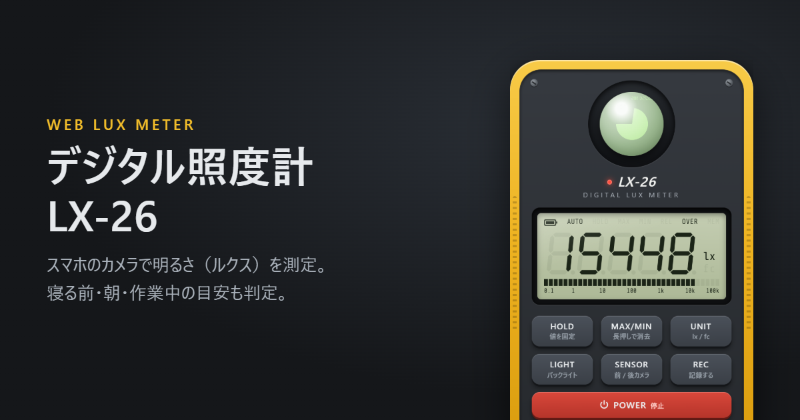

# デジタル照度計 LX-26（Web Lux Meter）

スマホのカメラで部屋や屋外の明るさ（照度・ルクス）を推定する、ハンディ照度計風の Web アプリです。
リビング・寝室・屋外などの場所の目安や、寝る前・朝・作業中などの時間帯・用途ごとに「ちょうどいい明るさか」を判定します。

**▶ https://m-masaki72.github.io/web-lux-meter/**



> [!WARNING]
> 表示される照度は**あくまで参考値**です。スマホカメラによる推定のため、専用の照度計ほど正確ではありません（目安として ±30〜50% 程度、端末によってはさらにずれます）。

## 機能

- 7セグメント液晶風の照度表示（lx / fc 切替）と対数バーグラフ
- HOLD、MAX/MIN（長押しで消去）、LCD バックライト、前／後カメラ切替
- 測定値の記録（端末内に保存）と共有
- 場所・環境の早見表と、時間帯・用途ごとの判定（寝る前／夜中／朝／作業／読書／団らん）
- 既知の照度に合わせるキャリブレーション（カメラごとに保存）
- PWA：ホーム画面に追加・オフライン起動・測定中の画面消灯防止

## 測定のしくみ

| 環境 | 方式 | 精度 |
|------|------|------|
| `AmbientLightSensor` が使える端末 | 照度センサーの値をそのまま使用 | 高 |
| カメラの露出を手動制御できる端末（主に Android Chrome） | 露出時間・ISO を自動調整し、`E = 250·N²·(Y/0.18) / (t·S)` で推定 | 中（参考値） |
| 露出を制御できない端末（iOS Safari など） | 自動露出下の画素の明るさから相対値を表示（LCD に `REL`） | 低（相対値） |

`N` は絞り値（f/1.8 と仮定）、`Y` は画面中央の平均輝度（リニア）、`t` は露出時間（秒）、`S` は ISO 感度です。機種差は補正係数で吸収します。

## 使い方

1. ページを開いて **POWER** を押し、カメラの使用を許可します。
2. 机や床の明るさを測るときは、前カメラを上に向けて置きます（レンズに白い紙をかぶせると照度計らしい値になります）。
3. 部屋の雰囲気を測るときは **SENSOR** で後カメラに切り替えてかざします。

## 開発

ビルド不要の静的サイトです。カメラは HTTPS（または `localhost`）でしか動かないため、ローカルでは簡易サーバーで開きます。

```sh
npx serve .
```

| ファイル | 役割 |
|----------|------|
| `index.html` | アプリ本体（HTML / CSS / JS を1ファイルに収録、JSON-LD・OGP を含む） |
| `sw.js` | Service Worker（オフライン対応）。更新時は `CACHE` のバージョンを上げる |
| `manifest.webmanifest` | PWA マニフェスト |
| `icons/` | アプリアイコン（`icon.svg` が元データ） |
| `og.png` | SNS 共有用画像（1200×630） |

GitHub Pages（`main` ブランチ直下）で公開しています。push するとそのまま反映されます。

## 照度の目安について

目安の数値は JIS Z 9110（照明基準総則）の推奨照度や、睡眠・概日リズムに関する一般的な推奨値をもとにした参考値です。

## ライセンス

[MIT](LICENSE)
